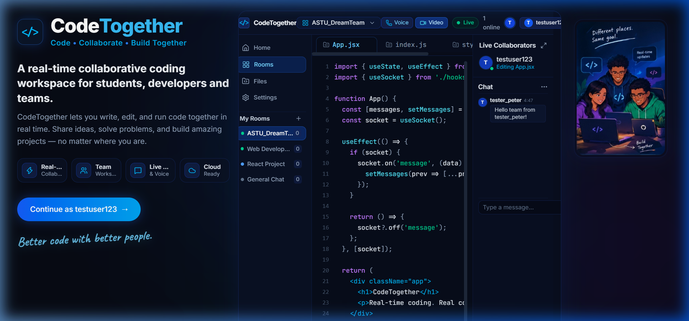
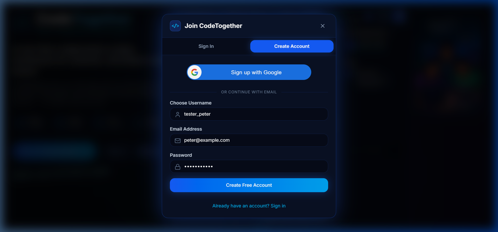
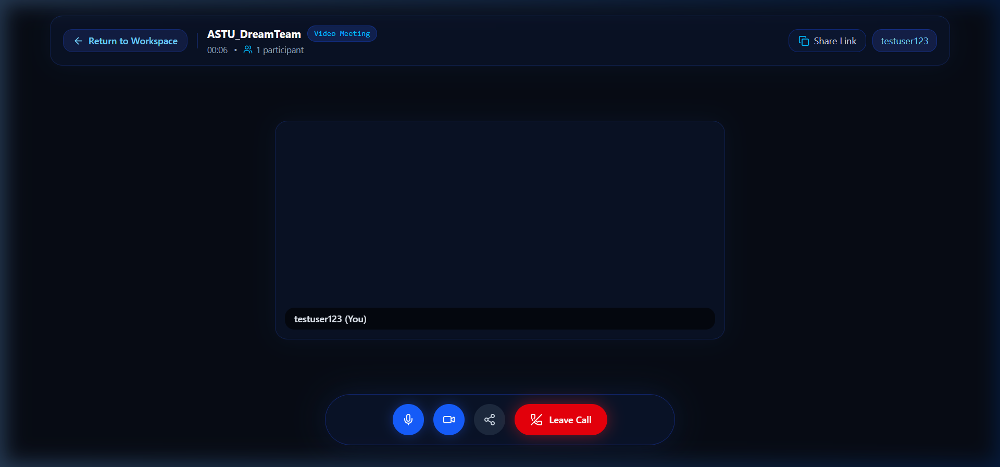

# 🚀 CodeTogether — Live Collaborative Coding, Voice & Video Workspace

<p align="center">
  
</p>

<h3 align="center">Code • Collaborate • Build Together</h3>

<p align="center">
  A production-ready, full-stack collaborative programming workspace where developers write code simultaneously, communicate through text, voice, and video, and build projects seamlessly in real time.
</p>

<p align="center">
  <a href="https://code-together-weld.vercel.app/"></a>
  <a href="https://codetogether-v1fo.onrender.com/api/health"></a>
  <a href="https://www.mongodb.com/atlas"></a>
  
  
</p>

---

## 🌐 Live Deployments & Quick Links

- 🖥️ **Live Web Application**: [https://code-together-weld.vercel.app](https://code-together-weld.vercel.app/)
- ⚙️ **Production API Health**: [https://codetogether-v1fo.onrender.com/api/health](https://codetogether-v1fo.onrender.com/api/health)
- 🐙 **GitHub Repository**: [https://github.com/petersisay/CodeTogether](https://github.com/petersisay/CodeTogether)

---

## 📸 Application Showcase

### 1. Unified Collaborative Workspace
Multi-user code editor with syntax highlighting, live socket cursor indicators, active file tabs (`App.jsx`, `index.js`, `style.css`), dynamic room presence, and real-time chat:

<p align="center">
  
</p>

<br />

### 2. Verified Google Identity & Account Registration
Official Google Identity Services (GIS) integration with server-side token signature verification, prominent Sign In / Sign Up switcher tabs, and local password authentication:

<p align="center">
  
</p>

<br />

### 3. Native WebRTC Voice & Video Meetings (`/meeting/:meetingId`)
Camera-independent audio calls and peer-to-peer mesh video meetings with speaking visualizers, mic/camera toggling, and dedicated meeting URLs:

<p align="center">
  
</p>

---

## 🌟 Core Features

| Feature | Description |
| :--- | :--- |
| ⚡ **Real-Time Code Collaboration** | Concurrent multi-user code synchronization powered by Socket.IO with file version tracking and collision notifications. |
| 🔒 **Verified Google Sign-In** | Google Identity Services button with backend validation of signatures, issuer, audience (`GOOGLE_CLIENT_ID`), expiration, and verified email status. |
| 🎙️ **WebRTC Voice & Video** | Native peer-to-peer media streaming with configurable mesh topology, speaking wave visualizers, and direct `/meeting/:meetingId` routing. |
| 📁 **Multi-File Project Rooms** | Tabbed code navigation, file creation, auto-saving, and deletion with permission-based authorization. |
| 💬 **Deduplicated Team Chat** | Instant messaging with single-dispatch WebSocket persistence to MongoDB Atlas, preventing duplicate records. |
| 👥 **Honest Presence Tracking** | Real-time collaborator avatars showing genuine connected users and their current file activity. Zero fake users or mock numbers. |
| 🛡️ **Workspace Data Retention** | Chat messages and editor drafts remain preserved on screen across sign-outs in view-only guest mode. |

---

## 🏗️ System Architecture

```
┌─────────────────────────────────┐               ┌─────────────────────────────────┐
│   Client A: React + Vite (SPA)  │◄═════════════►│   Client B: React + Vite (SPA)  │
│  • Google Identity Services     │               │  • WebRTC P2P Audio / Video     │
│  • Socket.IO Real-time Engine   │               │  • Real-time Syntax Editor      │
└─────────────────────────────────┘               └─────────────────────────────────┘
                 ▲                                                 ▲
                 │  WebSocket: Signaling, Live Sync, Chat          │
                 │  HTTP REST: Auth, Rooms, Files Hydration        │
                 ▼                                                 ▼
        ┌──────────────────────────────────────────────────────────────────┐
        │        Server: Node.js + Express + Socket.IO (Render)            │
        │  • Token Verification via google-auth-library                    │
        │  • JWT Handshake Authorization for Socket.IO Sessions            │
        │  • Room Mutating Endpoints & File Version Sequences              │
        └──────────────────────────────────────────────────────────────────┘
                                         ▲
                                         │ MongoDB Wire Protocol
                                         ▼
        ┌──────────────────────────────────────────────────────────────────┐
        │                 Database: MongoDB Atlas                          │
        │  • User Profiles (Google IDs, verified emails, local hashes)     │
        │  • Rooms, Files, and Persistent Chat Message History             │
        └──────────────────────────────────────────────────────────────────┘
```

---

## 🛠️ Technology Stack

- **Frontend**: React 19, Vite, Tailwind CSS, Lucide Icons, Socket.IO Client, Google Identity Services (`@accounts.google.com/gsi/client`), WebRTC APIs
- **Backend**: Node.js (ES Modules), Express.js, Socket.IO Server, Mongoose, Google Auth Library (`google-auth-library`), JWT (`jsonwebtoken`), `bcryptjs`
- **Database**: MongoDB Atlas
- **Testing**: Node.js native test runner (`node:test`, `node:assert`)
- **Deployment**: Vercel (Frontend SPA with rewrites), Render (Backend Web Service)

---

## 🔐 Security & Production Hardening

1. **Google ID Token Verification**: All Google tokens are verified server-side using Google's public certificates. Raw client profile claims are never trusted blindly.
2. **Account Takeover Protection**: Prevents automatic linking solely by email strings when an existing password account exists (returns HTTP 409).
3. **Socket.IO Handshake Auth**: Enforces JWT verification during WebSocket connection. Unauthenticated sockets cannot join collaboration rooms.
4. **Sender Identity Derivation**: Message sender and avatar are strictly derived from verified server session tokens, eliminating identity impersonation.
5. **Strict CORS Policy**: Whitelists authorized origins (`localhost:5173` and `https://code-together-weld.vercel.app`).
6. **No Duplicate Chat Messages**: Single-dispatch WebSocket persistence eliminates duplicate entries from simultaneous REST/Socket writes.
7. **Zero Demo Artifacts**: Eliminated all mock chat history, fake collaborator arrays, simulated online counts, and hardcoded demo identities.
8. **Read-Only Database Audit Tool**: Includes `npm run inspect-demo --prefix server` to safely audit legacy database records without data modification.

---

## 🧪 Automated Test Suite (28 Tests Passing)

CodeTogether features 28 unit and integration tests covering Google verification, authorization gates, real-time synchronization, and WebRTC signaling.

```bash
# Run backend test suite
npm test --prefix server

# Run client production build verification
npm run build --prefix client
```

### Verified Test Matrix:
- ✔️ Google ID token verification (valid signature, audience matching, issuer checking)
- ✔️ Token expiration, untrusted issuer, and unverified email rejection (401 / 403)
- ✔️ Account takeover prevention (protects existing local accounts)
- ✔️ JWT session generation and cryptographic verification
- ✔️ Unauthenticated access rejection for mutating room and file routes (401)
- ✔️ Unauthenticated socket rejection on `room:join`
- ✔️ Live presence broadcasting derived from active socket sessions
- ✔️ Code change broadcasting with collision detection & version sequences
- ✔️ WebRTC signaling (SDP offer/answer forwarding, ICE candidate routing, media status toggling)

---

## 🚀 Deployment Guide

### 1. Database — MongoDB Atlas
1. Create a cluster on [MongoDB Atlas](https://www.mongodb.com/atlas).
2. Configure a database user with read/write access.
3. Allow network access (`0.0.0.0/0` for cloud deployment).
4. Copy your connection string into `MONGODB_URI`.

### 2. Backend — Render
1. Connect your repository to Render as a **Web Service**.
2. Settings:
   - **Root Directory**: `server`
   - **Build Command**: `npm install`
   - **Start Command**: `npm start`
3. Environment Variables:
   - `PORT`: `5000`
   - `NODE_ENV`: `production`
   - `MONGODB_URI`: `<your_atlas_connection_string>`
   - `JWT_SECRET`: `<secure_32_character_random_secret>`
   - `CLIENT_URL`: `https://code-together-weld.vercel.app`
   - `GOOGLE_CLIENT_ID`: `764795198689-41h522pnno7r3ifmb6im3iu12418m31f.apps.googleusercontent.com`

### 3. Frontend — Vercel
1. Import the repository into Vercel.
2. Settings:
   - **Root Directory**: `client`
   - **Build Command**: `npm run build`
   - **Output Directory**: `dist`
3. Environment Variables:
   - `VITE_BACKEND_URL`: `https://codetogether-v1fo.onrender.com`
   - `VITE_GOOGLE_CLIENT_ID`: `764795198689-41h522pnno7r3ifmb6im3iu12418m31f.apps.googleusercontent.com`
4. Direct routes (e.g. `/meeting/:meetingId`) are automatically rewritten to `/index.html` via `client/vercel.json`.

### 4. Google Cloud Console Configuration
1. Open [Google Cloud Console](https://console.cloud.google.com/apis/credentials).
2. Select your OAuth 2.0 Web Client.
3. Add **Authorized JavaScript origins**:
   - `https://code-together-weld.vercel.app`
   - `http://localhost:5173` (for local development)

---

## 💻 Local Development Setup

```bash
# Clone the repository
git clone https://github.com/petersisay/CodeTogether.git
cd CodeTogether

# Install all dependencies
npm run install:all

# Start backend server (port 5000)
npm run dev:server

# Start frontend development server (port 5173)
npm run dev:client
```

Open `http://localhost:5173` in your browser.

---

## 📄 License

This project is licensed under the MIT License — see the [LICENSE](LICENSE) file for details.
