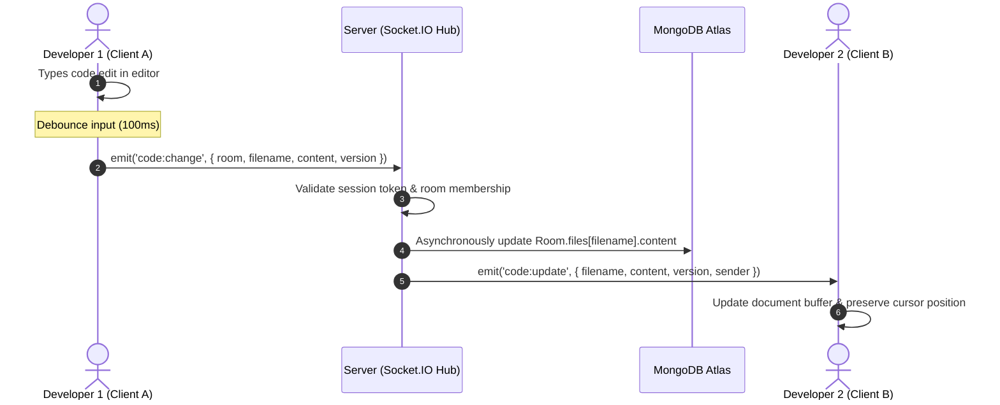
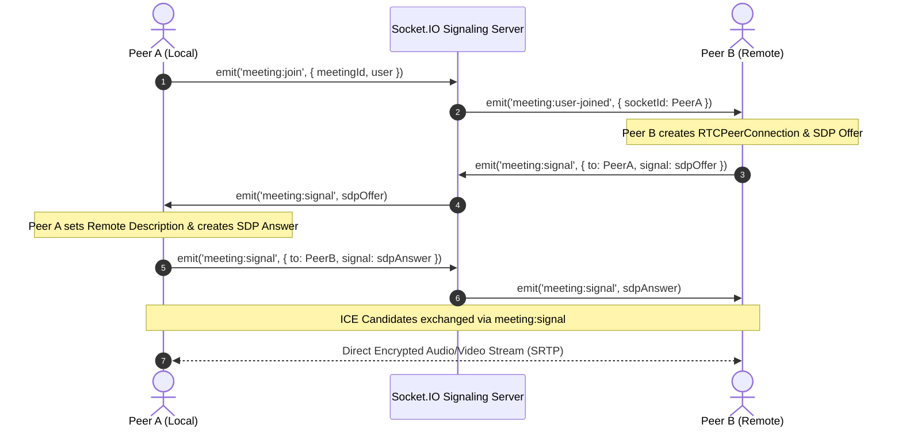
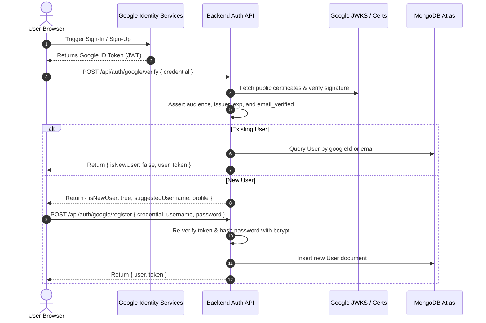
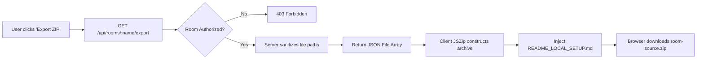

# 📘 CodeTogether — Deep-Dive System Architecture

**Project**: CodeTogether  
**Architect**: Peter Sisay ([@petersisay](https://github.com/petersisay))  
**Document Version**: 1.0.0  

---

## 📑 Table of Contents
- [1. High-Level System Topology](#1-high-level-system-topology)
- [2. Component & Tier Responsibilities](#2-component--tier-responsibilities)
- [3. Real-Time Code Synchronization Model](#3-real-time-code-synchronization-model)
- [4. WebRTC Peer-to-Peer Mesh Architecture](#4-webrtc-peer-to-peer-mesh-architecture)
- [5. Authentication, Identity & Session Flow](#5-authentication-identity--session-flow)
- [6. Security & Authorization Boundaries](#6-security--authorization-boundaries)
- [7. Persistence Strategy & Fallback Engine](#7-persistence-strategy--fallback-engine)
- [8. Project ZIP Export Pipeline](#8-project-zip-export-pipeline)

---

## 1. High-Level System Topology

```mermaid
flowchart TD
    subgraph Clients["Web Browser Clients (React 19 + Vite 8)"]
        ClientA["Client A (Developer 1)"]
        ClientB["Client B (Developer 2)"]
    end

    subgraph CDN["Frontend Hosting (Vercel CDN)"]
        VercelSPA["Production SPA Bundle<br/>HTML5 History Rewrites"]
    end

    subgraph Backend["Backend Cluster (Render Web Service)"]
        ExpressREST["Express REST API<br/>Authentication, Rooms, Export"]
        SocketHub["Socket.IO Real-Time Engine<br/>Rooms, Live Code Sync, Chat"]
        WebRTCSignaler["WebRTC Signaling Router<br/>SDP Offers, Answers, ICE Candidates"]
        AuthGuard["JWT & Google Auth Middleware<br/>google-auth-library + jsonwebtoken"]
    end

    subgraph Database["Cloud Database (MongoDB Atlas)"]
        UserCol[("Users Collection<br/>Bcrypt Hashes, Google IDs")]
        RoomCol[("Rooms Collection<br/>Multi-File Arrays, Access Whitelists")]
        MsgCol[("Messages Collection<br/>Chat History & Timestamps")]
    end

    subgraph STUN["NAT Traversal"]
        GoogleSTUN["Google Public STUN Servers<br/>stun.l.google.com:19302"]
    end

    ClientA -->|HTTPS Static Fetch| VercelSPA
    ClientB -->|HTTPS Static Fetch| VercelSPA

    ClientA -->|HTTPS REST Auth & Export| ExpressREST
    ClientB -->|HTTPS REST Auth & Export| ExpressREST

    ClientA <-->|WSS Bi-directional Sync| SocketHub
    ClientB <-->|WSS Bi-directional Sync| SocketHub

    ClientA <-->|STUN Binding Requests| GoogleSTUN
    ClientB <-->|STUN Binding Requests| GoogleSTUN

    ClientA <===>|Encrypted P2P Media Streams (SRTP)| ClientB

    ExpressREST --> AuthGuard
    SocketHub --> AuthGuard

    ExpressREST --> UserCol
    ExpressREST --> RoomCol
    SocketHub --> RoomCol
    SocketHub --> MsgCol
```

---

## 2. Component & Tier Responsibilities

### Presentation Layer (Client)
- **Role**: Render user interface, manage reactive state, capture editor input, and direct peer media streams.
- **Key Modules**:
  - `WorkspaceWindow.jsx`: Master IDE layout, tab management, and sidebars.
  - `SyntaxHighlighter.jsx`: Token-based syntax tokenizer and high-contrast colorizer.
  - `MeetingRoom.jsx`: WebRTC peer connection coordinator and audio visualizer.
  - `AuthModal.jsx`: Google Identity Services dialog handler.
  - `JSZip`: Client-side multi-file ZIP archive compiler.

### Transport & Application Layer (Server)
- **Role**: Verify credentials, manage room socket channels, maintain active collaborator presence, and sanitize export payloads.
- **Key Modules**:
  - `server.js`: HTTP bootstrap, CORS policy, and route aggregation.
  - `socket.js`: Socket session lifecycle, room routing, operational sequence tracking, and WebRTC broker.
  - `authRoutes.js`: Cryptographic Google OAuth verification and password hashing.
  - `roomRoutes.js`: File auto-saving, room creation, and sanitized export JSON generation.

### Persistence Layer (Database)
- **Role**: Durable multi-document storage for user accounts, workspace files, and persistent chat feeds.
- **Key Features**: Indexed queries on usernames, room names, and emails for sub-millisecond lookups.

---

## 3. Real-Time Code Synchronization Model

CodeTogether uses an event-driven synchronization model with version sequence numbers to ensure all collaborators maintain identical document states:



### Conflict Avoidance
- Each code change carries a monotonically incrementing `version` integer.
- The server records the active version per file in memory.
- If a client emits a change based on a stale version, the server notifies the sender to re-hydrate from the active head, preventing silent overwrites.

---

## 4. WebRTC Peer-to-Peer Mesh Architecture

Voice and video communication are established directly between participating web browsers in a peer mesh:



### Why Mesh Topology?
- **Zero Media Server Costs**: Media does not transit the Node.js server, keeping backend bandwidth negligible.
- **End-to-End Encryption**: Audio and video are encrypted point-to-point via SRTP/DTLS.
- **Optimal Group Size**: Ideal for pair-programming and small squads (2 to 6 participants).

---

## 5. Authentication, Identity & Session Flow



---

## 6. Security & Authorization Boundaries

### Room-Level Access Control
Rooms can be created as either **Public** or **Private**:
- **Public Rooms**: Any authenticated user may view files, collaborate, and export project code.
- **Private Rooms**: Restricted to the `creator` and users listed in `authorizedUsers`.
  - Mutating REST routes (`POST/PUT/DELETE /files`) reject unauthorized callers with `403 Forbidden`.
  - Project export route (`GET /:name/export`) rejects unauthorized callers with `403 Forbidden`.
  - WebSocket joins (`room:join`) reject unauthorized sockets with `error:unauthorized`.

### Path Traversal Defense
The project export endpoint accepts room names and aggregates stored code files. To ensure no attacker can inject paths referencing host filesystem resources or parent directories:
1. File names are stripped of null bytes (`\0`), Windows drive designators (`C:`), and UNC network paths.
2. Traversal segments (`../` or `..\`) are stripped via regex.
3. Leading slashes are trimmed, ensuring paths remain strictly relative.

---

## 7. Persistence Strategy & Fallback Engine

CodeTogether features an active dual-persistence engine:

```
                    +-----------------------------+
                    |  Express / Socket.IO Core   |
                    +--------------+--------------+
                                   |
                  Is MongoDB Atlas Connected?
                                  / \
                            Yes  /   \  No
                                /     \
                               v       v
               +-------------------+  +------------------------+
               |   MongoDB Atlas   |  | In-Memory Fallback     |
               |   (Production)    |  | (Local Dev & Testing)  |
               +-------------------+  +------------------------+
               | • User accounts   |  | • JavaScript Objects   |
               | • Seed rooms      |  | • Seed rooms initialized|
               | • Message logs    |  | • Full feature parity  |
               +-------------------+  +------------------------+
```

This design ensures:
- **Zero Offline Downtime**: Local development works out-of-the-box without requiring a local mongod daemon.
- **Ultra-Fast Automated Tests**: Native test suites run against the in-memory engine in ~2.4 seconds with zero external database dependencies.

---

## 8. Project ZIP Export Pipeline



This guarantees that developers can take their code offline at any moment and run it directly in **VS Code** with complete confidence in file integrity and safety.
